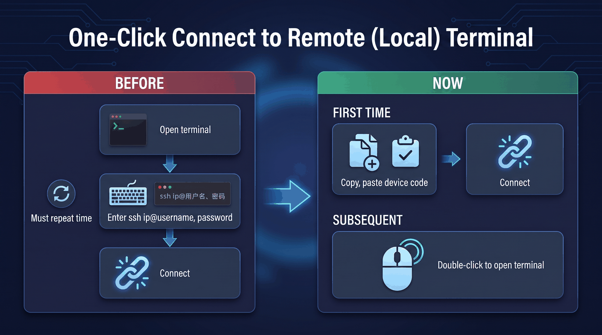
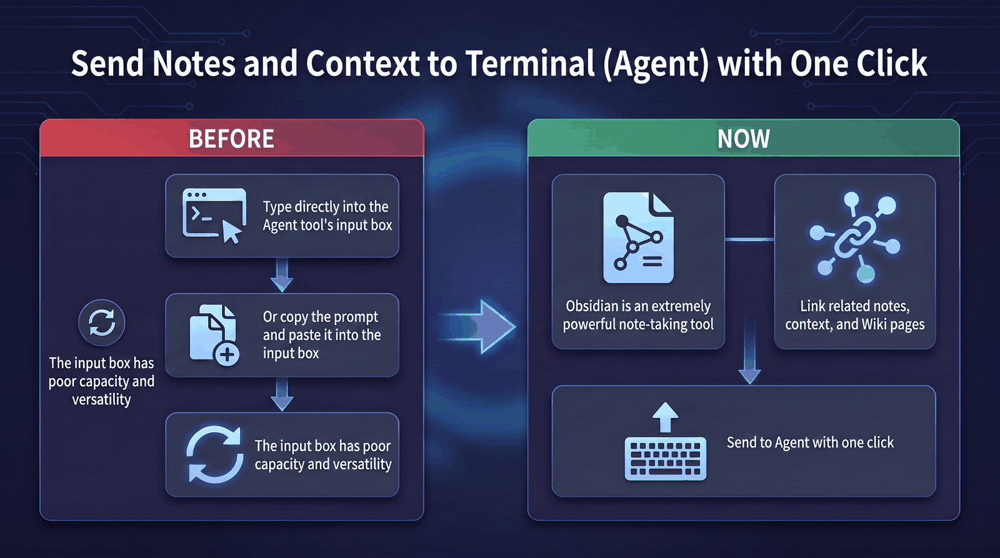

# LingXi1949

New in 4.0: bound remote file and command tools for Codex / Claude via MCP.
See the [setup guide](REMOTE_TASKS.md) and [validation record](IMPLEMENTATION_4.0.md).

First-time setup: [step-by-step instructions for the A, B and C devices (Chinese)](docs/remote-tasks-first-run.zh-CN.md).

English / [简体中文](./README_ZH.md)

**Stop moving context by hand: send notes to your agent in one click.**

<table>
  <tr>
    <td width="50%">
      
    </td>
    <td width="50%">
      
    </td>
  </tr>
</table>

## Features

- **Reach another computer without network setup:** pair a Windows or Linux device with a connection code—no account, public IP, or inbound port required. Connections prefer peer-to-peer and use an encrypted relay only when necessary.
- **Keep every task in its own terminal:** work across several devices and independent terminal sessions without one disconnected or closed session interrupting the others.
- **Stop hunting for paths:** double-click a directory to make the terminal enter it; double-click a file to insert its path at the AI TUI cursor. Dragging works too.
- **Put notes where the work is:** drag a note into the terminal or its directory tree and keep its Vault-relative structure. Per-file receipts and modification markers show what actually arrived.
- **Give the agent complete context:** send the current note, selection, or path in one action, with optional linked notes and recursively collected backlinks.
- **Avoid repeating terminal routines:** review session input, save useful steps as a device-specific shortcut group, and replay them later. LingXi1949 pauses instead of guessing when completion is uncertain.
- **Use your preferred AI CLI:** launch Claude Code, Codex, or OpenCode from one place and see availability before starting.
- **Keep private work private:** offline mode suppresses optional network checks, and LingXi1949 includes no client-side telemetry, usage analytics, or error-reporting beacon.

## New in 2.1

Update the plugin and its local backend or remote Agent together to use the new file operations.

- Preview built-in Claude Code, Codex, and OpenCode installation command groups for the selected platform and shell, or copy them into an editable custom group.
- Delete entries with confirmation and move entries by dragging within the directory tree when the connected local backend or remote Agent supports file operations.
- Open **Feedback & suggestions** from the device home header. The browser form supports Chinese and English, with feedback type, content, optional contact details, and images. The link includes the plugin version, language, and local operating system; version and system are saved with submitted feedback. No title or confirmation checkbox is required.

## Installation

LingXi1949 supports Obsidian Desktop only.

### Install the plugin

The recommended route is Obsidian Community Plugins:

1. Open **Settings → Community plugins** and turn off **Restricted mode** if it is enabled.
2. Select **Browse** and search for `LingXi`.
3. Install and enable **LingXi1949**.

For earlier access to the latest tagged build, install [BRAT](https://github.com/TfTHacker/obsidian42-brat) and add `Cyber-bike1949/LingXi1949`.

### Use a local terminal

Run **LingXi1949: Open terminal** from the Obsidian command palette and choose **This device**. Install and sign in to AI CLI tools such as Claude Code, Codex, or OpenCode separately on this computer.

### Connect a remote Linux Agent

Install the published **4.0.0** Linux x64 Agent (role C) as the current ordinary user, without sudo:

```bash
curl -fsSL https://raw.githubusercontent.com/Cyber-bike1949/LingXi1949/main/scripts/install.sh -o lingxi-install.sh && bash ./lingxi-install.sh --role c
```

Then run `~/.local/share/lingxi1949-install/bin/lingxi1949 run` and use its connection code for **Add device**. The installer verifies SHA-256, preserves identity, and does not start services automatically. Use `--role b` for Agent + MCP (requires Node.js 24+ and npm). See the [first-run guide](docs/remote-tasks-first-run.zh-CN.md) for Windows one-command installation and existing-service precautions. The legacy `agent/packaging/install-linux.sh` remains pinned to 2.1.0 and must not be used for 4.0 features.

For a locally compiled Agent, follow the [development guide](docs/development.md#33-rust-agent-lingxi1949).

### Connect a remote Windows Agent

Download the [Windows x64 Agent](https://github.com/Cyber-bike1949/LingXi1949/releases/latest/download/lingxi1949-win32-x64.exe) and its [SHA-256 checksum](https://github.com/Cyber-bike1949/LingXi1949/releases/latest/download/lingxi1949-win32-x64.exe.sha256), or run this block in PowerShell:

```powershell
$baseUrl = 'https://github.com/Cyber-bike1949/LingXi1949/releases/latest/download'
Invoke-WebRequest "$baseUrl/lingxi1949-win32-x64.exe" -OutFile 'lingxi1949.exe'
Invoke-WebRequest "$baseUrl/lingxi1949-win32-x64.exe.sha256" -OutFile 'lingxi1949.exe.sha256'
$expectedHash = (Get-Content 'lingxi1949.exe.sha256').Split()[0]
$actualHash = (Get-FileHash '.\lingxi1949.exe' -Algorithm SHA256).Hash
if ($actualHash -ne $expectedHash) { throw 'SHA-256 verification failed' }
.\lingxi1949.exe run
```

Keep the Agent running, then add the device with its connection code. Before using real content, verify `hostname` and `pwd` (`Get-Location` in PowerShell) and transfer a sample note that contains no personal information.

For build and test instructions, see the [development guide](docs/development.md).

> Be water, my friend! — Bruce Lee（活得像水一样吧，朋友。）
