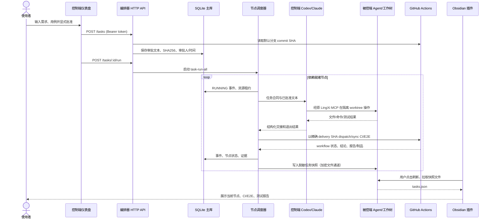

# LingXi 研发编排：技术架构说明

本文与[第一次使用指南](研发编排-新手使用指南.md)配套，解释每个用户操作背后的运行机制。当前版本是控制端运行的编排器 + 被控端 Agent + Obsidian 只读进度面板；**完整编排服务并未迁到被控端**。

## 1. 部署拓扑与信任边界

```text
┌──────────────── 控制端 ────────────────┐
│ Node 24 编排器 / SQLite / 本地仪表盘    │
│ Codex/Claude 登录 + LingXi MCP 绑定      │
│ gh 凭据 + GitHub API / Actions           │
└───────┬───────────────────┬─────────────┘
        │ 已配对 LingXi 加密会话            │ GitHub HTTPS/API
        ▼                                   ▼
┌───────────────────┐             ┌──────────────────┐
│ 被控端 LingXi Agent │             │ GitHub / Actions │
│ 项目克隆与隔离树    │             │ CI、E2E、RC 制品  │
│ 脱敏任务快照文件    │             └──────────────────┘
└─────────▲─────────┘
          │ 配对文件传输，只拉取状态
          │
┌─────────┴─────────┐
│ Obsidian 插件      │ 设备主页“研发任务”入口；渲染状态、报告与制品
└───────────────────┘
```

这是职责拆分，不是同一套程序的多个副本：SQLite 主库、审批文本和调度锁在控制端；被控端只保存面向展示的脱敏快照。插件不直接连接公网仪表盘，也不执行远程研发命令。手动终端、既有 AI MCP 绑定和普通文件传输仍按原路径工作。

**为什么暂不将完整服务搬到被控端：** 当前 Codex 登录、GitHub CLI 凭据及编排 worker 在控制端。把 HTTP 服务搬到 Windows 不会自动让它拥有这些能力；还必须新增安全的控制端任务桥接、双向事件协议、数据库主从/恢复语义和跨设备密钥管理。当前版本没有这些桥接，因此只把展示副本送到被控端，不能声称主库或调度器已迁移。

## 2. 一次任务的时序



## 3. 数据流与数据保存位置

```text
人工需求 + 测试用例
       │ 显式确认；字节级 SHA-256
       ▼
控制端 SQLite 主库 ──任务/节点/事件/租约──► Engine
       │                                  │
       │                                    ├─► AI prompt → LingXi MCP → 被控端 worktree
       │                                    ├─► gh → GitHub Actions / 下载制品
       │                                    └─► 证据/报告 URL 回写主库
       │
       └─projectTask 白名单投影（最多 30 任务、512 KiB）
                         │ 不含需求原文、AI 原始输出、本地路径、凭据
                         ▼
                被控端 orchestrator-status/tasks.json
                         │ 配对通道文件拉取
                         ▼
              Obsidian 面板（只读、本地呈现）
```

| 数据 | 主存位置 | 镜像到被控设备吗 | 用途 |
| --- | --- | --- | --- |
| 批准的需求与用例原文 | 控制端 SQLite | 否 | 为 AI 提供不可变任务合同 |
| 原文 SHA-256、审批人/时间 | 控制端 SQLite | 不复制到原文之外 | 审计审批版本 |
| 节点、事件、lease、交付 SHA | 控制端 SQLite | 摘要投影 | 调度、防并发、恢复 |
| 测试摘要、GitHub URL、制品种类/hash | 控制端 SQLite/制品目录 | 允许摘要字段 | Obsidian 展示证据 |
| AI 原始输出、控制端绝对路径、token | 控制端进程/存储 | 禁止 | 不跨边界暴露 |

主库 SQLite 是唯一事实来源；镜像更新时间和 `currentNode` 只是读取时根据事件生成的视图。镜像失败只影响可视化新鲜度，不应悄悄把任务状态改成成功或触发节点重放。

## 4. 调度器如何保证任务顺序

执行计划是有向无环图（DAG）：

```text
prepare-worktree → develop → git-verify → prepare-test-worktree → test
                                                         │
                                                         ▼
local-verify → ci ─┐
                   ├→ rc-build → rc gate → RC_READY
          e2e ─────┘
```

- `nextNodes` 只挑选依赖节点全部 `SUCCEEDED` 的节点；失败/未知不会冒充成功。
- `store.acquire` 对设备资源 ID + worktree 建租约，防止两个 session 并发写同一工作树；终止或明确恢复后才释放。
- `git-verify` 固定交付 commit SHA，并检查期望分支和干净状态。
- CI/E2E 查询必须匹配任务记录的 SHA 和命名 workflow；不接受其他分支或较新提交的“绿灯”。
- 测试 AI 在独立工作树执行；其报告仍需与同一个交付 SHA 关联。
- 每个节点先记 `RUNNING`，完成后写明确结果。如果进程中断，`recover` 将不确定节点标为 `UNKNOWN` 并要求人工核实，而不是重新发送有副作用的远程操作。
- 失败修复会使下游旧证据失效；自动修复最多三轮。第四次或遇到需用户决定的状态会停在 `BLOCKED_USER_DECISION`。

## 5. API、认证与服务监听

- `GET /health` 是健康探测；任务数据/API 默认需要 Bearer 令牌。
- `POST /tasks` 必须提供审批人、需求、测试用例与 `confirmed: true`；服务使用 SHA-256 冻结文本。
- `POST /tasks/:id/run` 只能启动本配置仓库中已批准且可启动的任务。
- 服务默认只监听 `127.0.0.1`。公网/非 loopback 监听要求强随机令牌与已完成 TLS 终止标记；正式使用优先私有网络/安全反向代理，不直接裸露任务执行端口。
- 浏览器将 token 放在当前 tab 的 `sessionStorage`，不是 URL 或 project 配置。
- 项目配置只存路径、仓库和可执行文件引用；不存 GitHub token、设备私钥或 AI 登录态。

## 6. Obsidian 进度面板

设备主页按钮在任意配对设备已连接时启用。面板按设备保存快照路径，复用插件已有配对连接与文件传输拉取，不新建 HTTP、WebSocket 或反向代理。UI 先检查 JSON 大小、schema/source 标记，再只渲染白名单字段；GitHub 报告链接仅接受 `https://github.com/`。

真实桌面 E2E 使用合成任务快照检查 Obsidian 能否读取阶段、workflow、测试摘要和报告链接。本轮实际通过的画面如下：

| 截图 | 说明 |
| --- | --- |
| [`obsidian-local-terminal.png`](assets/orchestrator/obsidian-local-terminal.png) | 本地终端在真实 Obsidian UI 中输入命令并显示回显 |
| [`obsidian-remote-device-connected.png`](assets/orchestrator/obsidian-remote-device-connected.png) | 被控 Agent 在设备主页显示已连接，且远程终端可重连 |
| [`obsidian-task-progress-report.png`](assets/orchestrator/obsidian-task-progress-report.png) | 配对设备真实传输任务镜像，在工作区视图显示节点、GitHub CI 和测试报告信息 |

截图不得包含真实设备名、绝对路径、需求原文、访问令牌或个人项目数据。

**验证边界：** 候选版 `5.0.7` 的 Linux 与 Windows hosted runner 均通过六项真实 Obsidian UI 场景：插件加载、本地终端、终端输入/输出、添加并连接被控 Agent、断开/重连、通过 Agent 拉取并渲染任务镜像（展开任务节点、workflow 状态、测试摘要和报告链接）。任务镜像是合成测试数据，不能据此声称 GitHub 上真实项目的开发/测试/发布任务已执行。既有“操作历史”modal 不在本轮 E2E 覆盖范围，相关功能未改动。

## 7. 可恢复性和运维

运行时默认目录为控制端 `~/.lingxi-orchestrator/`：SQLite、私有制品目录和相关状态应按敏感研发资料保护并备份。被控端快照可重建，不能用于数据库恢复。`serve` 只负责 UI/API；需要后台持续推进时单独运行 `worker`。当服务或 worker 被终止，按事件轨迹和远端真实状态恢复后，再用 `task-retry` 明确选择节点。

完整配置、命令和新手操作见[第一次使用指南](研发编排-新手使用指南.md)和[编排器 README](../packages/orchestrator/README.md)。
