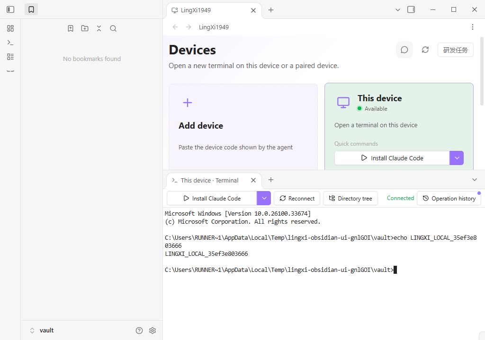
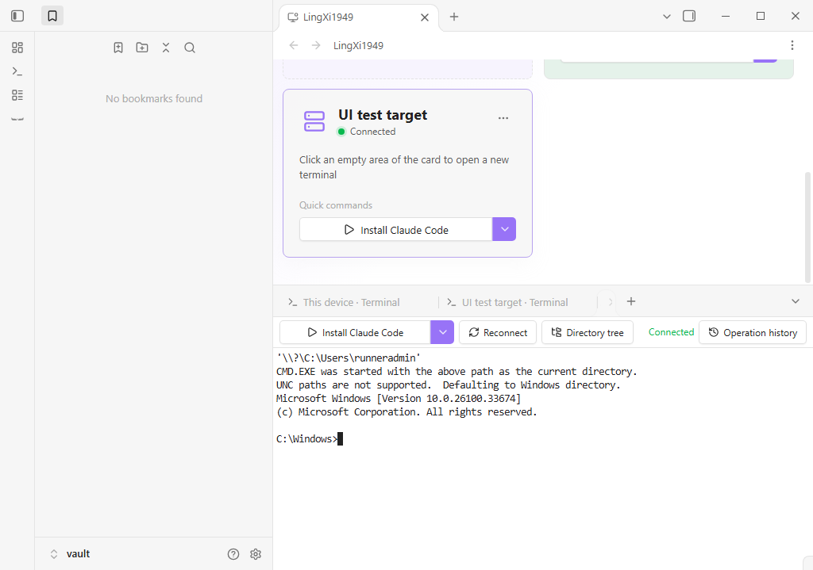

# LingXi 研发编排：第一次使用指南

本文带你从“准备一次任务”走到“在 Obsidian 查看测试结果”。先读完部署位置说明，再按顺序操作。Linux/macOS 控制端示例使用 Bash；Windows 控制端请把环境变量命令换成 PowerShell 写法。

> **先说明当前版本怎么部署：** 编排器、任务数据库、AI CLI 与 GitHub CLI 运行在控制端；被控设备运行 LingXi Agent、项目工作树，并保存一份脱敏的任务进度镜像。Obsidian 插件通过已配对的加密设备通道读取镜像。任务进度入口在 Obsidian 中，但这不等于完整调度服务已迁移到被控设备。Codex 无需、也不应为了本功能登录被控设备。

## 一、先认清三台“角色设备”

| 角色 | 运行什么 | 要不要登录 Codex/GitHub |
| --- | --- | --- |
| 控制端 | Node.js 24、编排器、Codex/Claude CLI、`gh` | 使用者在这里完成 AI CLI 与 GitHub CLI 登录 |
| 被控端 | LingXi Agent、Git 仓库和隔离工作树 | 不要求 Codex 登录；本方案不把控制端凭据复制过去 |
| Obsidian 桌面 | LingXi1949 插件、任务进度面板 | 用已配对设备连接读取状态；不直接执行研发任务 |

同一台电脑可以承担多个角色，但首次体验推荐按上表理解职责。若 Obsidian 不在运行编排器的控制端，仍需从可访问控制端仪表盘的安全网络路径使用创建表单；插件面板本身仅查看进度。

## 二、一次性准备

### 1. 安装并连接被控设备

在被控设备启动 LingXi Agent，再从 Obsidian 添加设备并配对。确认设备主页显示已连接。研发项目应在该设备上有自己的 Git 克隆目录；不要将已有个人工程目录直接用作本功能的工作树根目录。

在控制端验证已有选择：

```sh
lingxi devices --probe true
lingxi select --device <被控设备ID> --workdir <被控端项目目录> --shell <Shell绝对路径>
```

Windows 的 shell 可使用 `C:\Windows\System32\cmd.exe` 或 Agent 实际支持的 PowerShell 完整路径。`select` 会产生供项目配置使用的 session ID。不要把设备配对身份、连接码或私钥放入项目 JSON。

### 2. 准备 AI CLI 与 GitHub 登录

在**控制端**安装并登录要用的 Codex/Claude CLI，并确保 LingXi MCP 绑定到期望的被控设备。Codex 使用任务级 MCP 覆盖参数，不会改写你的全局 Codex 配置。

```sh
codex login status
gh auth status
gh repo view <owner/repo>
```

GitHub 令牌只保存在 `gh` 自己的凭据存储中，不要写进 `project.json`。应只授予访问目标仓库和所需 Actions 的权限。

### 3. 写项目配置

复制 [`project.example.json`](../packages/orchestrator/project.example.json) 到项目自己的私有配置目录，例如 `~/.lingxi-orchestrator/web-demo.json`。至少检查以下内容：

- `repository`：`owner/repo` 形式的目标仓库。
- `commands`：项目真实的测试、构建命令。
- `runtime.gh`：控制端 `gh` 可执行文件；通常直接写 `gh`。
- `runtime.remotes.development` 和 `runtime.remotes.test`：LingXi CLI、session、设备资源 ID、目标仓库根目录、各自工作树根目录和 shell 类型。若只有一台被控设备，仍须使用不同的开发/测试 worktree 根目录。
- `runtime.agent`：控制端 Codex/Claude 可执行文件、参数和 `target: "local"`。如果用任务级 LingXi MCP，配置已有绑定对应的 `agent.mcp`；不要把 `target` 改成 `remote`，除非明确要在被控端安装并登录 AI CLI。
- `runtime.workflows`：仓库中真实存在的必需 CI、E2E 与 RC workflow 名称/文件。
- `runtime.taskMirror`：Obsidian 查看用镜像的临时相对路径和被控端最终绝对路径。最终目录应在代码仓库之外并允许 Agent 写入；Linux 示例使用 POSIX 路径，Windows 请换成该设备的绝对盘符路径。

配置中路径仅作例子，必须换成你的设备实际路径。不要提交包含真实用户名路径或 session ID 的个人配置。

### 4. 运行只读预检

```sh
node packages/orchestrator/src/cli.mjs preflight --project ~/.lingxi-orchestrator/web-demo.json
```

只有 `passed: true` 才继续。预检会检查 LingXi session、被控端 Git、控制端 AI CLI 与登录、GitHub CLI 和 workflow；不会创建任务分支、工作树或 Actions 运行。失败时根据 `checks[].kind` 修复对应配置后重跑。

## 三、启动任务入口

在控制端生成至少 32 字符的临时访问令牌并启动本机仪表盘：

```sh
export LINGXI_ORCHESTRATOR_TOKEN="$(openssl rand -hex 32)"
node packages/orchestrator/src/cli.mjs serve \
  --project ~/.lingxi-orchestrator/web-demo.json \
  --host 127.0.0.1 --port 43194
```

Windows PowerShell 可用 Node 生成同样的随机令牌：

```powershell
$env:LINGXI_ORCHESTRATOR_TOKEN = (& node -e "process.stdout.write(require('node:crypto').randomBytes(32).toString('hex'))")
node .\packages\orchestrator\src\cli.mjs serve --project "$env:USERPROFILE\.lingxi-orchestrator\web-demo.json" --host 127.0.0.1 --port 43194
```

保持这个终端运行，在控制端浏览器打开 `http://127.0.0.1:43194/`，粘贴令牌登录。不要把服务改成无认证公网监听；非 loopback 监听还需要 TLS 终止保护。令牌仅存在当前进程环境与当前浏览器 tab 的 session storage。

首次打开页面时，列表为空是正常的。只要服务没有启动，任务创建和进度刷新都不可用。

## 四、创建并启动一项任务

在“创建研发任务”表单填写：

1. **任务标题**：一句话描述目标，例如“任务列表增加状态筛选”。
2. **审批人**：填写实际评审并批准的人名。
3. **需求文档**：说明用户目标、包含/不包含范围、边界条件和可观察的验收结果。
4. **测试用例**：按步骤列出前置条件、操作、预期结果；覆盖正常、异常和回归情形。
5. 检查复选框确认需求与用例已经评审。提交意味着验收文本会冻结并计算 SHA-256。

点击“创建并执行任务”后，服务会读取默认分支 SHA、创建任务记录并启动编排。若要 AI 辅助起草需求/用例，使用 `document-draft` 生成草稿，再由人检查、修改和批准；草稿不会自动视为审批通过。

### 执行阶段会发生什么

任务通常依次经过：

1. **准备开发工作树**：从批准的基准 SHA 创建任务分支和隔离工作区。
2. **AI 开发**：控制端 Codex/Claude 通过已绑定的 LingXi MCP 读写被控设备上的工作区；它不会改动另一个任务的工作树。
3. **Git 校验**：确认提交存在、分支/工作树干净并记录交付 SHA。
4. **独立测试**：测试代理在独立测试工作树上使用冻结用例验证该 SHA。
5. **本地质量检查**：在配置的工作区运行 lint/test/build 命令。
6. **GitHub CI/E2E**：只接受对应交付 SHA 的必需 workflow 成功结果，不以“最新一次”或其他 SHA 的成功替代。
7. **RC 门禁**：构建候选制品并检查所有必要证据。达到 `RC_READY` 不等于已经批准正式发布。

默认失败会停下来供人检查；只有显式开启自动修复，编排器才会回到开发节点重试。修复会清除下游旧证据，并要求重新通过提交与 CI/E2E 校验。

## 五、在 Obsidian 查看进度

确保被控设备仍在线。先在控制端任务日志确认镜像配置成功，然后打开 LingXi1949 设备主页，点击 **研发任务**；也可以在命令面板运行“远程模型任务”。首次使用时：

1. 选择目标被控设备。
2. 数据类型选择“研发编排任务”。
3. 将 `runtime.taskMirror.remoteFinalPath` 的同一条绝对路径填入“状态镜像文件”；按设备分别保存。
4. 点击“刷新任务”。
5. 展开任务卡片，查看当前节点、各节点结果、GitHub workflow、测试摘要/交接报告和制品摘要。

下面两张截图来自 Windows 上的真实 Obsidian UI 测试，展示本地终端命令回显，以及被控 Agent 连接/重连后的设备卡片。设备名和命令内容均为合成数据。





注意：以上截图不是研发任务进度面板截图。托管 Obsidian UI runner 当前未能挂载插件 modal，因此任务进度面板的成功画面尚未取得；在补齐该项验证前，不应将候选版视为正式可发布版本。

进度面板是只读的。它通过已配对设备连接拉取 JSON 镜像，不打开新端口、不保存需求原文/原始 AI 输出/控制端制品路径/凭据。页面显示镜像生成时间；若时间过旧，先确认控制端编排器和被控设备连接，不要把旧的 `RUNNING` 或成功状态当作实时状态。

> 任务面板本身的截图会在 modal UI 通过真实 Obsidian 桌面 E2E 后补入 [`docs/assets/orchestrator/`](assets/orchestrator/)，并标明测试版本；不会用手工拼接图代替真实交互结果。

## 六、故障排查与恢复

| 现象 | 检查与处理 |
| --- | --- |
| 登录后只能看，不能创建 | `/meta` 提示预检失败时检查 `preflight` 失败项；确保服务同时配置了项目和令牌。 |
| `GITHUB_DEFAULT_BRANCH_SHA_UNAVAILABLE` | 检查默认分支名称、仓库权限与控制端 `gh auth status`。 |
| 研发任务页面读不到文件 | 检查设备在线、session 绑定、路径拼写与 Agent 账户目录权限；镜像最终路径必须是被控端绝对路径。 |
| 任务镜像长时间不变 | 控制端执行日志若有 `TASK_MIRROR_*` 错误，先解决 Agent 写入/文件传输问题。镜像失败不会自动判定任务成功或失败。 |
| 同一工作树被占用 | 不要手工删除活跃工作树；检查资源租约和旧任务状态，确认旧任务已结束再显式恢复。 |
| 进程意外退出后任务为 `BLOCKED_USER_DECISION` | 先运行 `recover` 并核对 Git SHA、LingXi 任务记录和 GitHub Actions；系统不会猜测远程命令或 workflow 的结果。确认后用 `task-retry` 显式指定恢复节点。 |
| CI 显示绿但任务没有通过 | 确认 workflow 的 commit SHA 与任务记录的 delivery SHA 完全一致，并确保所有必需 workflow 均已完成。 |

## 七、停止与数据位置

- `Ctrl+C` 停止前台仪表盘；已提交给子进程的任务执行不会因此自动撤销。
- 主任务数据库和原文审批记录位于控制端 `~/.lingxi-orchestrator/orchestrator.sqlite`，权限为用户私有；需按组织策略备份/保护。
- Obsidian 所读镜像位于被控设备的 `remoteFinalPath`，仅用于展示，可以重新生成；它不是主数据库备份。
- Actions 制品与测试报告按项目配置/仓库保留策略存储。正式发布需要独立审批，本任务流程不会自动发正式版本。

更完整的节点状态、事件模型、数据流、安全边界和恢复原理见[技术架构说明](研发编排-技术架构说明.md)；命令与配置参考[编排器开发文档](../packages/orchestrator/README.md)。
