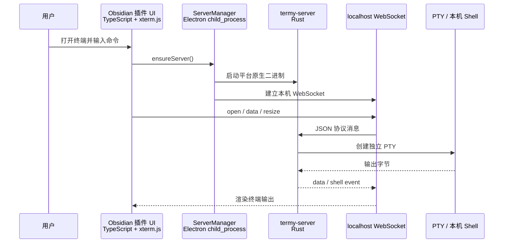
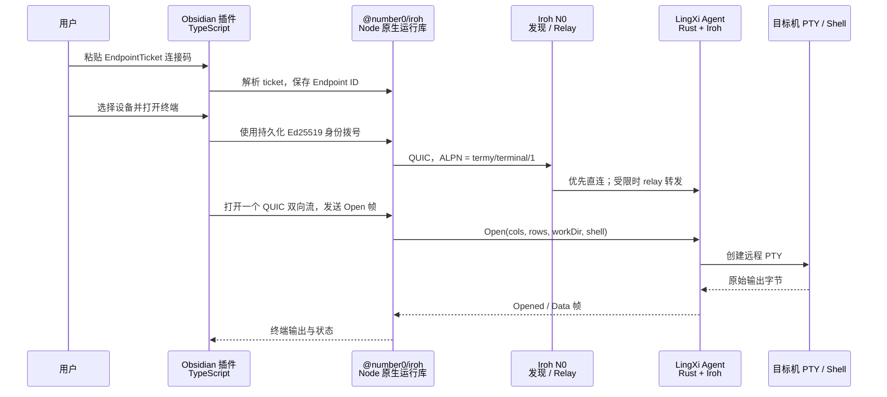
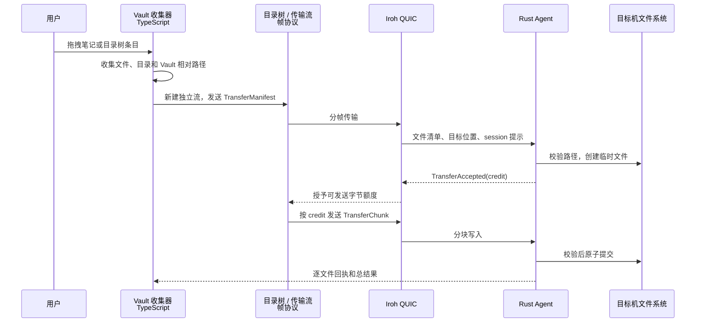
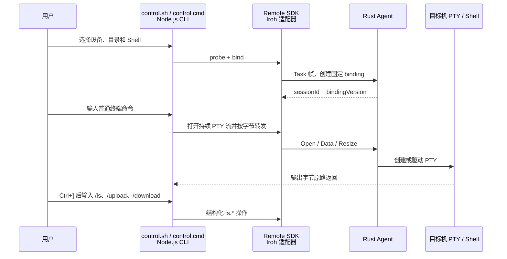
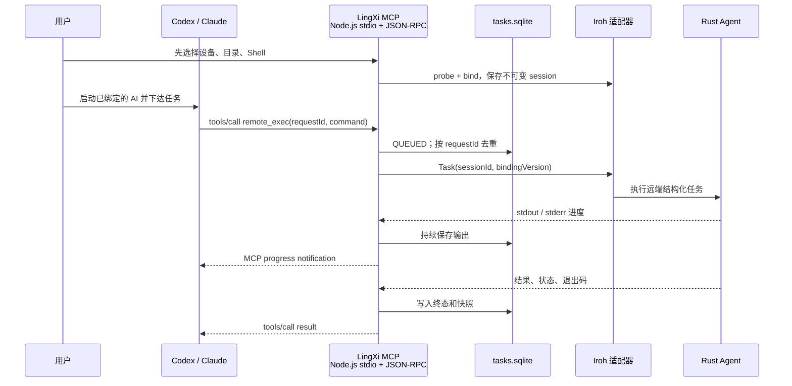
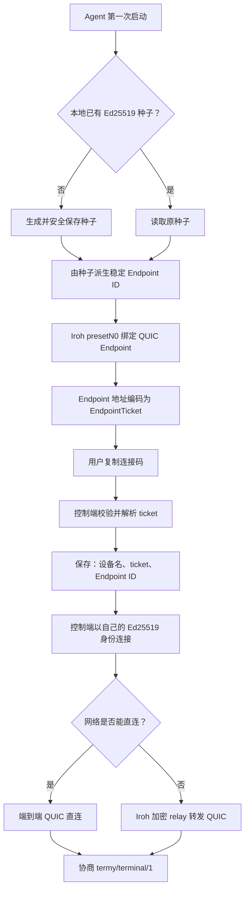
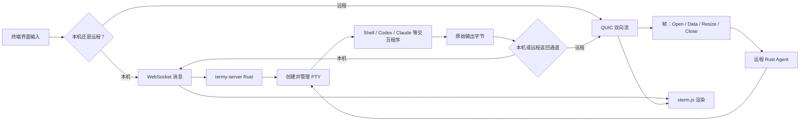
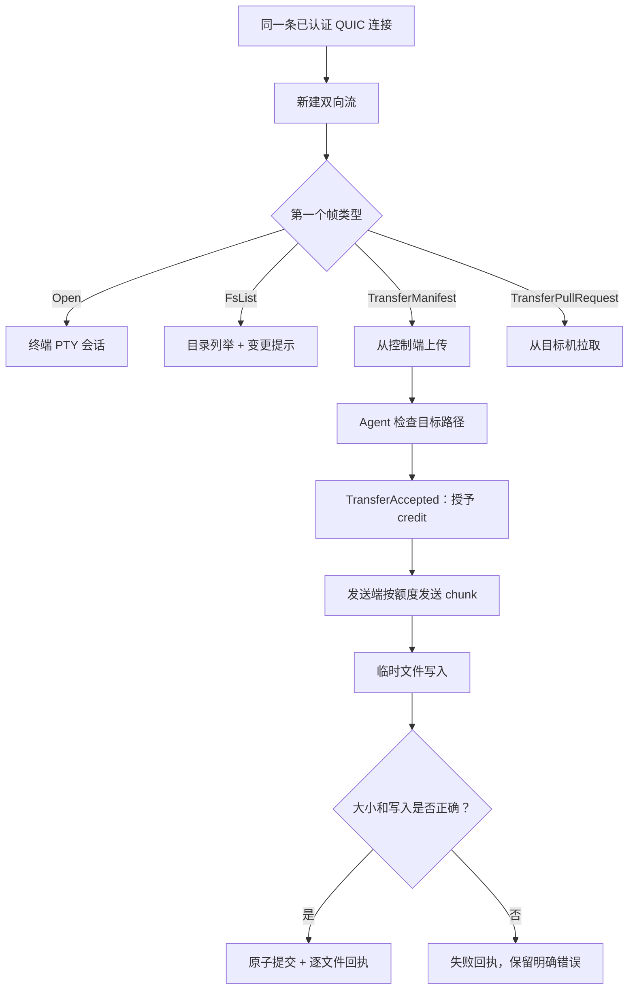
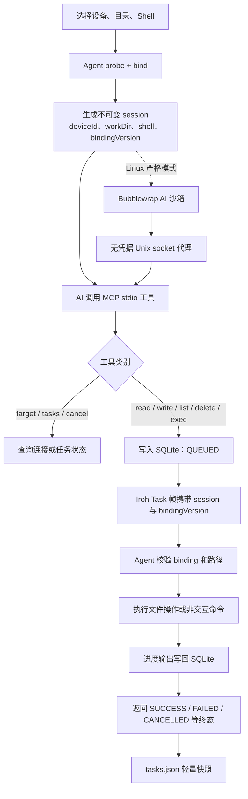
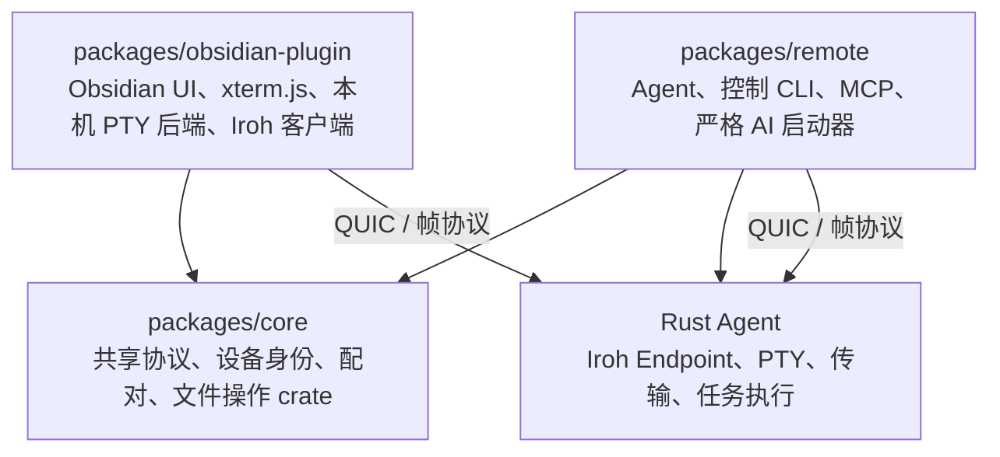

# LingXi1949 实际技术方案

> 依据当前仓库代码整理。本文描述已经落在 `packages/obsidian-plugin`、`packages/remote`、`packages/core` 中的实现，不把规划中的能力写成已交付能力。

## 1. 使用场景：在时序图中看见工具

LingXi 的入口是 Obsidian 插件或 Remote 控制端；目标机始终由 Rust Agent 实际执行。以下每张时序图只描述一个用户动作，并将当次参与的技术工具单独标在参与者名称中。

### 1.0 读图前先统一 6 个概念

| 名词 | 给前端工程师的解释 | 在本项目中的具体含义 |
| --- | --- | --- |
| 控制端 | 发起连接和展示界面的机器 | Obsidian 所在电脑，或运行 `control.sh` / `control.cmd` 的电脑 |
| 目标机 / Agent | 真正运行命令的一端 | 常驻的 Rust `lingxi1949` 进程；项目文件和 Shell 都在这里 |
| PTY | 像真实终端窗口一样工作的进程通道 | 不只执行一条命令，而是保存 Shell 的 `cd`、环境变量和交互状态 |
| Iroh Endpoint | 带长期身份的网络端点 | 由 Ed25519 种子派生 ID；连接码可以让另一端找到并验证它 |
| QUIC 双向流 | 一条连接里的独立子通道 | 一个 PTY、一次目录查询或一次文件传输各占一个流，互不混写 |
| binding | AI/文件操作的不可变目标约束 | `deviceId + workDir + shell + sessionId + bindingVersion`；创建后不能由模型参数改写 |

前端不需要实现 QUIC 或 PTY。它负责三件事：保存设备与控制端身份、调用 `DeviceConnectionManager` 打开连接/流、把流的事件更新到 xterm.js、目录树和传输进度 UI。网络和系统调用由 Iroh 原生库与 Rust Agent 完成。

### 1.1 在 Obsidian 打开本机终端



关键工具是 xterm.js（渲染与输入）、Electron（拉起本机进程）、Rust PTY 后端（维持真实终端状态）和 localhost WebSocket（插件与后端通信）。这不是“每行运行一次 Shell”：当前目录、前台程序、方向键和 Ctrl+C 都保留在同一个 PTY。

前端落点：`TerminalInstance` 将 xterm.js 的输入和尺寸变化交给 `PtyClient`；`ServerManager` 懒启动后端、维护 WebSocket，并在后端重启后重连。UI 不直接调用 `child_process` 或解析 PTY 字节。

### 1.2 在 Obsidian 连接并使用远程终端



这里的连接码只携带目标端点地址和身份，不需要 LingXi 账户。Iroh 的 N0 负责地址发现和必要的加密 relay；真正执行命令、访问文件的是目标机 Agent，而不是控制端或 relay。

前端落点：连接码的表面校验和设备持久化在 `pairDevice` / `PairedDeviceStore`；真正拨号在 `DeviceConnectionManager.connect(nodeId)`。连接状态只有 `disconnected`、`connecting`、`connected`、`error` 四类，UI 应订阅状态变化后刷新，不应根据按钮文字或设备名称猜测连接是否存在。

### 1.3 从 Obsidian 向远端交付笔记或文件



传输使用独立 QUIC 流，不占用终端输入。目录浏览使用 `FsList` 首帧，上传使用 `TransferManifest`，从远端复制回 Vault 使用 `TransferPullRequest`；三者都复用同一条已认证连接。

前端落点：目录树通过 `createDirectoryTreeSource(nodeId)` 获取数据源；发送笔记通过 `createTransferSender(...)`；复制回 Vault 使用 `createTransferPuller(...)`。它们都要求设备已经连接，失败时应显示传输结果中的逐文件错误，不能把“流断开”显示成“已完成”。

### 1.4 不打开 Obsidian，使用 Remote 手动控制



普通输入只会送到远程 PTY；`Ctrl+]` 后才进入控制命令入口，避免将 `/upload` 误传给 vim 等前台程序。手动 `cd` 只影响该 PTY，文件命令仍固定在创建 binding 时确认的目录。

### 1.5 让 Codex 或 Claude 操作远程项目



MCP 暴露的远程工具为 `remote_target`、`remote_read`、`remote_write`、`remote_delete`、`remote_list`、`remote_exec`、`remote_tasks` 和 `remote_cancel`。它们不能通过参数更换设备、工作目录或 Shell；同一个 `requestId` 重复调用会返回原记录，内容不同则报冲突。

这里的 MCP 是 AI CLI 与 Node.js 服务之间的标准输入/输出协议，不是浏览器接口。Obsidian 若要展示 AI 任务历史，只读取控制端生成的 `tasks.json` 快照，不会经由 Obsidian 再转发一遍 AI 命令。

## 2. 技术工具：用流程图说明其内部工作

### 2.1 Iroh、Ed25519 与 EndpointTicket：建立可验证的设备连接



`presetN0` 是生产配置，包含发现与 relay；loopback 配置仅用于测试，会关闭 relay 并只绑定 `127.0.0.1`。Agent 只允许一个控制连接，新控制端连入时会关闭旧连接。旋转 Agent 身份会让旧连接码失效。

### 2.2 PTY、帧协议与 QUIC 流：维持交互式终端



远程帧格式是“1 字节类型 + varint 长度 + 负载”。`Data` 保持原始字节，`Open`、`Resize`、`Close` 等控制信息用 JSON；因此 TypeScript 与 Rust 只需保持帧编码兼容。连接关闭时，Agent 会终止该连接下的 PTY 进程树。

### 2.3 目录与文件传输：通过首帧分流、credit 控制背压



credit 是接收端允许发送的字节额度，避免发送端无限制缓存。目录变更由 Agent 轮询后发出提示，不等同于实时同步。Remote CLI 的二进制传输最大 64 MiB；MCP 的 UTF-8 读写最大 128 KiB。

### 2.4 MCP、SQLite 与 Bubblewrap：固定目标并保留任务证据



文件路径必须位于 binding 根目录，拒绝 `..` 与符号链接越界；删除不递归。`remote_exec` 的 stdin 关闭，默认超时 120 秒、最大一小时，同一 Agent 同时只运行一条结构化命令。工作目录是文件工具的边界而非操作系统沙箱，命令仍以 Agent 用户权限运行。Linux 严格模式将真实 MCP 与配对资料保留在宿主机，AI 沙箱只拿到 Unix socket；Windows 尚不提供严格运行时，启动会拒绝而不降级。

### 2.5 前端接入远程终端时的状态与错误处理

```mermaid
flowchart TB
  A[用户点击设备] --> B{DeviceConnectionManager 状态}
  B -->|disconnected / error| C[connect(nodeId)]
  B -->|connecting| D[禁用重复连接，显示连接中]
  B -->|connected| E[createTerminalTransport(nodeId)]
  C --> F{连接结果}
  F -->|成功| E
  F -->|失败| G[状态设为 error<br/>展示 CONNECT_FAILED 信息]
  E --> H[TerminalInstance 打开流]
  H --> I{Open 是否返回 Opened？}
  I -->|是| J[xterm.js 开始收发 Data]
  I -->|否| K[关闭该终端实例并显示打开失败]
  J --> L{连接或流是否关闭？}
  L -->|否| J
  L -->|是| M[停止输入，保留已显示输出<br/>提示远程终端已断开]
```

不要在断线时自动把用户输入改为本机执行；Remote SDK 和 MCP 在断线后将无法确认结果的结构化任务标为 `UNKNOWN`，因为“是否已经在目标机执行”不可凭空推断。重新连接后应新建终端或 session，而不是复用旧流。

## 3. 三个包各自负责什么



| 包 | 已实现职责 | 不负责的事 |
| --- | --- | --- |
| `packages/core` | 终端帧编码、连接码校验、配对设备存储、控制端身份处理；`fs-operations` Rust crate 提供共用文件操作 | 不导入 Obsidian，也不依赖任一产品 UI |
| `packages/obsidian-plugin` | Obsidian 视图、终端实例、目录树、笔记上下文收集、平台 PTY 后端管理、Iroh 原生运行库加载与设备连接 | 不承担 Remote MCP 的任务持久化和严格 AI 沙箱 |
| `packages/remote` | 面向命令行的安装/配置、目标 Agent、控制端 CLI、MCP stdio 服务、任务 SQLite、Bubblewrap 严格模式 | 不需要 Obsidian 才能连接或执行 |

## 4. 现行与保留代码的边界

当前 Obsidian 打开远程终端的入口使用 `DeviceConnectionManager`：它加载 Iroh、读取已配对设备并以 `termy/terminal/1` 连接 Agent。插件源码中仍保留 `RemoteService` / `RelayClient` 一组基于 HTTPS 登录和 Relay 控制连接的旧服务层，以及对应测试；它不是 `createRemoteTerminalInstance` 的现行远程终端路径。本文的架构图和流程图均以 Iroh P2P 主链路为准。

## 5. 代码依据与维护入口

| 关注点 | 主要实现位置 |
| --- | --- |
| Obsidian 远程连接与 Iroh 运行库 | `packages/obsidian-plugin/src/services/remote/deviceConnections.ts`、`irohRuntime.ts`、`irohStreams.ts` |
| 插件本机 PTY 后端 | `packages/obsidian-plugin/src/services/server/serverManager.ts`、`packages/obsidian-plugin/rust-servers/` |
| Agent 的身份、端点与接入 | `packages/remote/agent/src/identity.rs`、`p2p.rs`、`serve.rs` |
| 帧协议与文件传输 | `packages/core/src/services/remote/terminalStreamFrame.ts`、`packages/remote/agent/src/termstream.rs`、`transfer.rs` |
| MCP、任务记录与 AI 严格模式 | `packages/remote/packages/lingxi-mcp/protocol.mjs`、`service.mjs`、`store.mjs`、`strict-ai.mjs` |

维护协议时必须同时检查 TypeScript 帧编码与 Rust `termstream` 的兼容性；更改行为时按包独立构建、测试，不能把任一入口的临时实现当作另一个入口的正式依赖。
